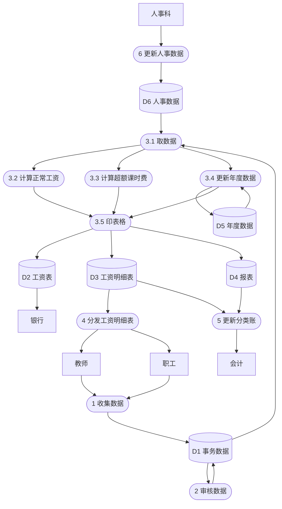

“Docker 后面主要用于运行 PostgreSQL 和 Qdrant”，我认为的Docker就是对于环境的打包，那你说的这两个功能是什么意思。

> 1. PostgreSQL是普通的关系型数据库，用来保存结构化数据：用户，会话，聊天消息，记忆内容，创建时间，更新时间，置信度；Docker不是PostgreSQL，本质上，Docker负责把PostgreSQL跑起来，PostgreSQL负责保存数据。
> 2. Qdrant是向量数据库，负责根据意思相似来搜索内容，它不是按关键词完全匹配，而是比较文字转换后的向量距离。Qdrant 官方将它定义为向量相似度搜索引擎。
